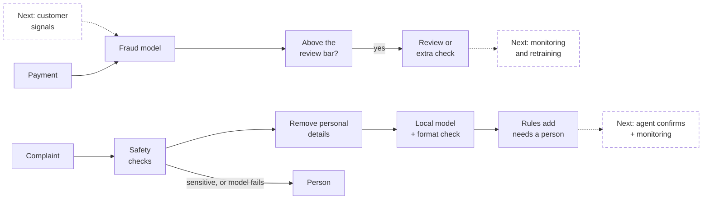
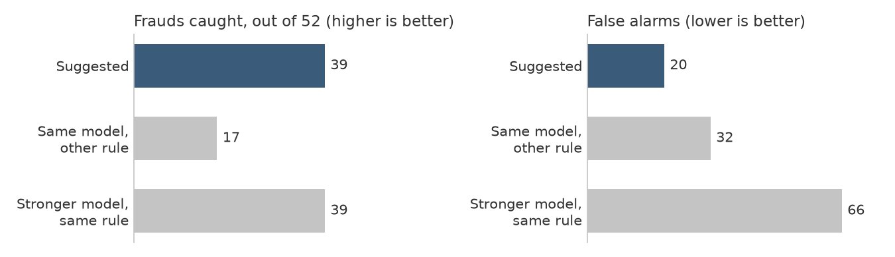
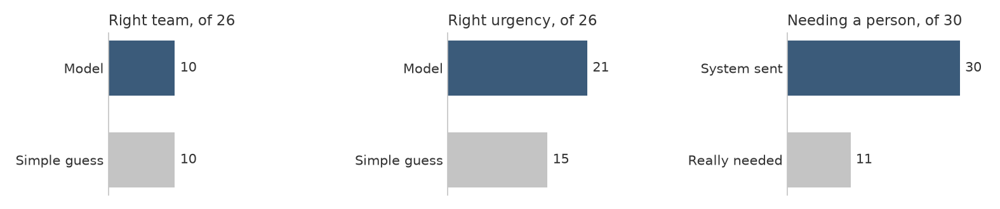

# PayGuard: fraud detection and complaint triage

PayGuard has two problems: fraud losses are rising, and the support team cannot keep up with customer complaints. We asked two questions. Can a model spot fraudulent card payments? Can a language model sort complaints safely? We built and measured a first version of each on public data, with a local dashboard. **Fraud detection is worth taking further. Complaint sorting has a safe processing flow, but the model we tested is not good enough to use.** This is a foundation, not yet connected to PayGuard.

## What we are asking for

**Fund stage 1 only: offline testing on PayGuard's own data.** It changes no payment and no customer reply, and is not a request to deploy.

| | Fraud | Complaints |
|---|---|---|
| Time (our estimate) | 6–10 weeks | 3–4 weeks |
| PayGuard provides | Past payments with customer history and confirmed fraud; today's fraud rules and results; the cost of a review and of a false alarm | 6–12 months of complaints with final routing, kept in-country; customer languages; two labelers |
| Continue only if | It beats current controls on later, unseen payments, at the same review workload | Labelers agree well enough, privacy is signed off, and a model clearly beats simple guessing on teams, and keyword rules alone on which cases need a person, without sending everything to a person. It must pass the attack tests or have an agreed safeguard |

**Team:** a machine learning engineer and a data engineer full time, plus part-time help from a fraud analyst, a support lead and a privacy officer. With both tracks side by side, that is about 12–20 engineer-weeks. Staff time and test hardware are not yet priced. **Agree the pass marks before testing.** No catch rate or time saving can be promised yet, and stopping after stage 1 is a valid result.

## Done now and next

| | Built and measured | Next, for production (not built) |
|---|---|---|
| Fraud | Two models tested on later payments; a cost-based review rule | Scoring service beside the payment system; up-to-date customer signals; decision log; monitoring and retraining |
| Complaints | Safety checks, redaction, local model, safe fallback; 400 processed | Better model; PayGuard's categories; self-hosted server with standby; agent screen; monitoring |

## How it fits together

Solid boxes are built; dashed boxes come next.



Models only **suggest**: nothing is blocked or closed automatically. Complaint text **stays on our machine**, because redaction failed our manual review.

## Results

**Fraud: promising.** Trained on earlier payments, tested once on later ones (42,561 payments, 52 frauds). With so little fraud, accuracy is meaningless, so we count frauds caught and false alarms.



- **Suggested start:** the simpler model, flagging payments with over a 4.2% chance of fraud: **39 of 52 caught, 20 false alarms**, for an estimated €2,667 against €6,169 if nothing is flagged. We chose it **after** seeing these results, so expect somewhat worse on new data.
- **Errors differ:** a missed fraud loses its amount; a false alarm costs a review and may lose a customer, which we could not price. The other rule costs about the same and is cheaper when reviews are expensive. The stronger model's small edge is **not proven**.
- **In real time,** the key signals will be recent customer behaviour, missing from this data, so the model must stay small and fast ([more](docs/technical_notes.md#real-time-use)).

**Complaints: safe flow, weak model.** [400 public US complaints](docs/technical_notes.md#data) processed; one person labeled 30 without seeing the model's answers.



- **It sent all 400 to a person**, saving no review work, and chose the right team **no more often than a simple guess**.
- Of 10 summaries, **1 was wrong or misleading**. 6 of 9 attack tests passed; in one failure, a hidden instruction kept a complaint away from a person.

## Taking it to production

Both follow one path: **prove it offline, run it unseen, let people use it, then automate a little.**

| Stage (our estimate) | Fraud | Complaints | Move on only if |
|---|---|---|---|
| 1. Offline: 6–10 / 3–4 weeks | Build history signals from PayGuard data | Two labelers; compare better models | The tests in [our request](#what-we-are-asking-for) are met |
| 2. Unseen trial: 4+ weeks | Score live payments, change nothing | Sort live complaints, unseen by agents | Catch rate, false alarms and speed are acceptable |
| 3. Assisted: 6–8 weeks | Flags go to analysts | Agents confirm every suggestion | Faster work, no more losses or reopened complaints |
| 4. Limited automation | Extra checks on high-risk payments | Auto-assign low-risk categories | Monthly review; one switch turns it off |

- **Fraud in production** (not built or costed; all in-country): a scoring service answers while the payment waits, using customer signals prepared in advance, and logs each decision. If it is slow or down, today's controls apply.
- **Fraud monitoring:** flag rate, speed and failures daily; shifts in payment patterns weekly; catch rate and false alarms as fraud is confirmed, which also drives retraining.
- **Complaints in production:** a self-hosted model with a standby, in-country. Two servers at an assumed US$0.50–1.50 an hour each cost **US$730–2,190 a month** for 50,000 complaints (US$0.015–0.044 each), before staff. The [memo](memo.md) covers complaint monitoring, privacy and retention.

## Assumptions

| Assumption | Why |
|---|---|
| Public data and one labeler can test the method | No PayGuard data yet; the numbers will not carry over |
| A review costs €5; a flagged fraud is stopped | No real figures; they change which rule is best |
| Complaint data stays in the country | PayGuard's regulator requires it |
| Server prices | Planning figures, not quotes |

## Run it

macOS (Apple Silicon), Python 3.12, from the repository folder:

```bash
brew install libomp uv && uv venv --python 3.12 && uv pip install -r requirements.txt
source .venv/bin/activate && python -m pytest -q
python -m streamlit run app/dashboard.py      # open http://localhost:8501
```

For the fraud page, save [Kaggle's](https://www.kaggle.com/datasets/mlg-ulb/creditcardfraud) `creditcard.csv` as `data/raw/creditcard.csv`. For live complaint sorting, install [Ollama](https://ollama.com), run `OLLAMA_NO_CLOUD=1 ollama serve` and `ollama pull llama3.2:3b`; otherwise saved answers are shown. Read the [technical notes](docs/technical_notes.md#reproducing-the-results) before re-running results.

**Left out:** model tuning and deep learning (method matters more now), other language models and a second labeler (time and an 8 GB laptop), and a real-time service (needs PayGuard's systems).

**More:** [Memo to the CTO](memo.md) · [Technical notes](docs/technical_notes.md) · [How AI was used](AI_USAGE.md) · [Specification and decision log](docs/process/SPECS.md)
