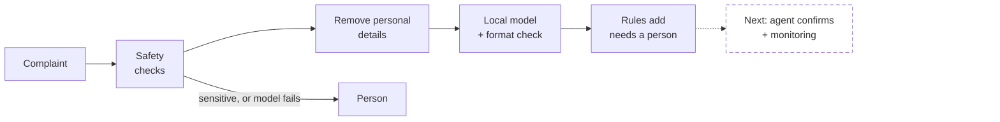

# PayGuard: fraud detection and complaint triage

PayGuard has two problems: fraud losses are rising, and the support team cannot keep up with customer complaints. We asked two questions. Can a model spot fraudulent card payments? Can a language model sort complaints safely? We built and measured a first version of each on public data, with a local dashboard. **Fraud detection is worth taking further. Complaint sorting has a safe processing flow, but the model we tested is not good enough to use.** This is a foundation, not yet connected to PayGuard.

## Where it stands

| | Done now | Next, to reach production |
|---|---|---|
| Fraud | Two models compared on later, unseen payments; a decision rule based on cost | PayGuard's own data, customer history signals, real-time scoring, monitoring |
| Complaints | Rules, redaction, local model, safe fallback; 400 complaints processed | A better model, PayGuard's complaints and categories, agent screen, monitoring |

## How it fits together

Solid boxes are built; dashed boxes come next. The **fraud** flow:


The **complaint** flow:



Models only **suggest**. Complaint text **stays on our machine**: redaction failed our manual review.

## Results

### Fraud: promising

We trained on earlier payments and tested once on later ones (42,561 payments, 52 frauds). Fraud is so rare that a model catching none would still be "over 99% accurate", so we judge by frauds caught, false alarms and ranking quality (PR-AUC) instead.


- **Suggested start:** the simpler model (logistic regression), flagging payments with over a 4.2% chance of fraud: **39 of 52 frauds caught, 20 false alarms**. We chose this **after** seeing the test results, so expect somewhat worse on new data.
- **Estimated cost:** €2,667 at €5 a review, against €6,169 if nothing is flagged. The other rule costs about the same (€2,649): it catches fewer frauds but misses about as much money, and at €25 a review it is clearly cheaper.
- **Errors differ:** a missed fraud loses the amount, handling and trust; a false alarm costs a review and may lose a customer. We priced only the review and the amount.
- XGBoost ranked frauds slightly better (0.757 against 0.700; 1 is perfect): **not proven** with so few frauds.
- **Real time:** the key signals will be recent customer behaviour, missing here. They must be ready within the payment's time limit, so keep the scoring model small and fast. Speed is untested.

### Complaints: safe flow, weak model

We processed [400 public US complaints](docs/technical_notes.md#data); one person labeled 30 blind. Invented categories are rejected.


- **It sent all 400 to a person**, saving no review work. It chose the right team **no more often than always guessing the most common one**; urgency was better.
- Of 10 summaries, 1 was complete, 8 missed a detail and **1 was wrong or misleading**.
- Attack tests: 6 of 9 passed. In one failure, a hidden instruction stopped a complaint from being sent to a person.

## Taking it to production

Both follow one path: **prove it offline, run it unseen, let people use it, then automate a little.**

| Stage (our estimate) | Fraud | Complaints | Move on only if |
|---|---|---|---|
| 1. Offline: 6–10 and 3–4 weeks | Build history signals from PayGuard data | Two labelers; compare better models | Fraud beats current controls at equal review work; complaints clearly beat simple guessing without escalating everything |
| 2. Unseen trial: 4+ weeks | Score live payments, change nothing | Sort live complaints, unseen by agents | Catch rate, false alarms and speed are acceptable (fraud is confirmed weeks later) |
| 3. Assisted: 6–8 weeks | Flags go to analysts | Agents confirm every suggestion | Faster work, no more losses or reopened complaints |
| 4. Limited automation | Extra checks on high-risk payments | Auto-assign low-risk categories | Monthly review; one switch turns it off |

- **Team (estimate):** a machine learning engineer and a data engineer full time; part-time fraud analyst, support lead, two labelers and privacy officer.
- **Infrastructure, all in-country:** fraud needs a scoring service beside the payment system, current customer signals and logging (not yet costed). Complaints need a self-hosted model with a standby: at 50,000 a month, two servers at an assumed US$0.50–1.50 an hour cost **US$730–2,190 a month** (US$0.015–0.044 per complaint), before staff.
- **Review effort costs more:** if every complaint still goes to a person, at an assumed 3–6 minutes each, that is 2,500–5,000 hours a month.
- **What to expect:** no catch rate or time saving can be promised yet. Stage 1 decides whether to continue; stopping is a valid result. The [memo](memo.md) covers complaint monitoring, privacy and retention.

## Assumptions

| Assumption | Why, or why it matters |
|---|---|
| Public data and one labeler can test the method | No PayGuard data yet; the numbers will not carry over |
| A review costs €5 (also tried €1, €25) | No real figure, and it changes which rule is best |
| A flagged fraud is stopped; a false alarm costs only the review | Keeps it simple; PayGuard should price both properly |
| Complaint data stays in the country | PayGuard's regulator requires it |
| Server prices; 3–6 minutes a review | Planning figures, not quotes or measurements |

## Run it

On macOS (Apple Silicon) with Python 3.12, from the repository folder:

```bash
brew install libomp uv && uv venv --python 3.12 && uv pip install -r requirements.txt
source .venv/bin/activate
python -m pytest -q
python -m streamlit run app/dashboard.py      # open http://localhost:8501
```

- **Fraud page and tests:** save [Kaggle's](https://www.kaggle.com/datasets/mlg-ulb/creditcardfraud) `creditcard.csv` as `data/raw/creditcard.csv`.
- **Live complaints (no API key):** `brew install ollama`, `OLLAMA_NO_CLOUD=1 ollama serve`, then `ollama pull llama3.2:3b`. Without it, examples show saved answers.
- **Reproducing results:** read the [technical notes](docs/technical_notes.md#reproducing-the-results) first; some scripts overwrite saved results.

## What we left out, and why

- **Tuning, ensembles, deep learning:** method matters more than score now; fraud results are untuned.
- **Other models, a second labeler, larger samples:** limited time and an 8 GB laptop.
- **Real-time service, production screens:** they need PayGuard's systems.

**More:** [Memo to the CTO](memo.md) · [Technical notes](docs/technical_notes.md) · [How AI was used](AI_USAGE.md) · [Specification and decision log](docs/process/SPECS.md)
